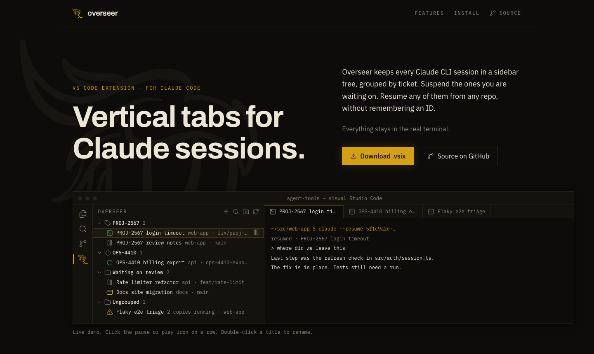

# Overseer

Vertical tabs for Claude CLI sessions in VS Code. Sessions stay real terminals.

[Site](https://tory37.github.io/djaunt-overseer/) · [Download the .vsix](https://github.com/tory37/djaunt-overseer/releases/latest)



## Why

- `claude --resume` only lists sessions that started in the current directory. A fix that started in one repo can't be found from another.
- Idle sessions waiting on review still hold memory. Closing one means remembering its ID to get it back.
- Ten terminal tabs across the top don't say which ticket each one is for.
- The PR and ticket a session worked on are buried in its transcript.

## Features

### Find and resume
- **All Sessions** (search icon in the title bar) lists every Claude session from every repo. Enter resumes it in the directory it started in and pins it to the sidebar.
- `repo:<name>` filters by every repo a session touched, not only the one it started in.
- Sessions that edited files in other repos show `+N repos`.

### Session History
- **Session History** (history icon in the title bar, or the button in All Sessions) opens a page that lists every session. It searches title, prompts, recap, branch, folder, and PR. `repo:<name>` works here too.
- Filter by All, Pinned, or Running, by repo, and by age (idle 7+ days up to 1+ year).
- The detail pane shows the recap, first and last prompt, branch, repos, PR, and commits. **Open** resumes the session. **Pin**, **Copy ID**, and **Open Transcript** are next to it.
- **Delete…** removes one session from your machine for good: its transcript, subagent and tool output, `file-history`, `session-env`, its prompts in `~/.claude/history.jsonl`, and Overseer's pin, label, group, and status. A confirm screen lists everything first. Nothing goes to the Trash.
- **Purge…** deletes every session the current filters show. Pinned sessions are skipped. Purging more than one asks you to type the count.
- Running sessions are never deleted.

### Workspaces (experimental)
> Experimental. It works, but it needs more testing. Report anything odd.

- **Switch Workspace** (the layers item on the left of the status bar) keeps sets of sessions, terminals, and groups apart, like work and after hours. **Default** always exists.
- New sessions, terminals, and groups join the current workspace. **Move to Workspace…** (right-click) moves one.
- A switch suspends the running Claude sessions, closes the terminals and file tabs, then brings back what was open in the other workspace. Terminals come back as fresh shells in the same folder.
- It asks first when Claude is mid-task or a file has unsaved changes. Cancel changes nothing.
- Untitled tabs and tabs pinned in VS Code stay open in every workspace. Split layouts don't come back.

### Group
- Pinned sessions group by the ticket key in their name, branch, or first prompt (`PROJ-2567`).
- **New Group** (title bar) makes your own group. Drag sessions into it.
- Renaming a ticket group turns it into your own group in the same spot.
- Each group row has **+** (new session in that group) and **search** (pull an existing session into that group).

### Reorder
- Drag a group onto another group, or a session onto another session.
- Dragging down puts the item after the target. Dragging up puts it before. VS Code trees can't show an insertion line.
- The order syncs across windows.
- Links reorder in the Session sidebar. See [Links](#links).

### Run
- Clicking a session with a terminal in this window focuses the terminal. Clicking any other session opens it in the [preview](#session-preview).
- **New Session** (+) asks for a folder and an optional name, then runs `claude --session-id <id> -n <name>` in an editor terminal.
- **New Terminal** asks the same questions, then opens a plain shell in that folder. It sits in the Terminals view, under the same groups as your sessions. It acts like a session: click to focus, drag into a group, Rename, Remove, Kill. When it is closed, **Open** starts a new shell in the same folder. Claude-only actions do not show on it.
- Clicking a terminal tab selects that session's row in the sidebar. A row that is already selected stays, so a multi-select survives.
- **Suspend** (pause) sends `/exit`, so the process and its memory go away. It warns first when Claude is mid-task.
- **Resume** (play) brings the session back with its history.
- **Rename** (F2 or double-click) renames the row and its tab. When the session is idle in this window, it also sends `/rename`. A tab that comes back from a reload without its name gets it again when you focus it.
- **Kill and Remove** (right-click) closes the terminal, ends the process, and unpins it. The transcript stays, so All Sessions can still resume it.
- **Remove from Sidebar** only unpins.
- Hovering over a session shows its name, state, and status. Everything else is in the Session sidebar.
- The Claude actions (Compact, Clear, Model, Cost, Run command) are in the Session sidebar. See [Session sidebar](#session-sidebar).

### Statuses
- **Set status** (Session sidebar, or **Set Status…** in the palette for the selected rows) marks a session or terminal with a status. **Clear Status** removes it.
- The defaults are Todo, Triage, In Progress, Blocked, AI Review, Human Review, and Ready to Ship. They do not follow Jira, so a status like Triage works.
- A status with **Ask why** on (Blocked, by default) asks for a reason when you set it. Press Enter to skip. The reason shows in the row's tooltip and on the badge's hover. Setting another status clears it.
- A status tints the row's label and adds a short badge on the right, like `IP`. The icon shows in the picker and the hover, so the row keeps one icon.
- **Settings…** → **Statuses** adds, renames, reorders, and deletes statuses, and sets each one's color, icon, badge, and whether it asks why. Renaming keeps the status on its sessions. **Reset to defaults** restores the seven.
- Colors come from a palette of nine theme colors, because tree labels take only theme colors. They follow your light or dark theme. If a badge shows with no tint, turn on `explorer.decorations.colors`.
- The list is the `overseer.sessionStatuses` setting. Each session's status is saved in the extension's state.

### Compacting
- A session that is compacting shows a spinning sync icon in place of its running icon.
- Claude Code doesn't report compaction anywhere Overseer can read, so this needs two hooks. A `PreCompact` hook writes a marker file to `~/.claude/overseer/compacting/`, and a `PostCompact` hook deletes it. A marker older than 10 minutes is ignored.
- On startup, Overseer offers to install the hooks when they are missing. **Overseer: Install Compact Hooks** and **Overseer: Remove Compact Hooks** in the Command Palette do the same any time. Install backs up `~/.claude/settings.json` first and leaves your own hooks alone.

### Repos
- Overseer works in a window with no folder open. It reads git straight from the repos your sessions use.
- The **Repos** view, under Terminals, lists every repo a pinned session or terminal works in. The most recently active repo is on top.
- Each row shows the branch, commits ahead and behind its upstream, and the count of changed files, like `main · ↑2 ↓1 · 5 changed`. The icon turns amber when there are uncommitted changes.
- Rows update a second after anything changes in the repo's `.git` folder, and when the window gets focus. Git runs only while the view is open.
- **Open Repo in Source Control** (the inline icon, **Open repo** in the Session sidebar, or the palette) adds that repo to VS Code's Source Control view, so its graph, changes, and diffs work there. A session that touched more than one repo asks which.
- **Open Repo in New Window** and **Copy Repo Path** are on the right-click menu.
- Expand a repo to see its last 20 commits on the current branch: subject, short hash, and age.
- A commit a Claude session made shows a green sparkle and the session's name. Overseer knows a session made it when the transcript holds that commit's `git commit` output. It doesn't guess from timing.
- Click a commit to open its diff. Right-click for **Show Session**, **Open Commit on GitHub**, and **Copy Commit Hash**.

### Session sidebar
- The **Session** view in the Secondary Side Bar (Cmd+Option+B) follows the focused session: a Claude terminal or the preview tab. It opens once on its own, the first time a Claude terminal gets focus.
- The header shows the session's name, state, folder, and branch. Under it is the summary: Claude Code's own recap, or a Haiku summary if that one is newer. **Summarize with Haiku** writes a new one from the end of the transcript. It runs only when you click it.
- **Suspend** or **Resume** sits under the summary. A session running in another window offers a fork instead.
- **Actions** holds the rest:
  - **Claude**: Compact, Clear, Model, Cost, and Run command. They send `/compact`, `/clear`, `/model`, `/cost`, or one of your saved prompts. They show only for a session running in this window, and they wait until it is idle.
  - **Session**: Summarize, Find links, Open repo, Set status, and Rename.
- **Run command** prompts come from the `overseer.sessionCommands` setting, as `{name, prompt}` entries, like "Latest reviews are in on the PR. Pull them and evaluate." A `{ticket link}` in a prompt asks for that value first.

### Session preview
- A session with no terminal in this window opens in one reused **Session Preview** tab. Clicking another session replaces it.
- It shows where the session left off, its last turns, its prompts, the commits and pull requests it made, and the other repos it touched.
- **Resume** opens the terminal in the preview's place and closes the preview.
- The preview reads the transcript and git, so it costs nothing and never starts Claude.

### Links
- **Working on** lists the tickets and PRs the agent declared and the ones you pinned, with live status, summary or title, and the agent's note. **+** pins a ticket by key.
- **Also seen** (collapsed) lists the other GitHub PRs, Jira tickets, and claude.ai artifacts in the transcript. **Find links** scans for them. Overseer never scans on its own.
- A headless `claude -p` run with Haiku sorts the scanned links into owned, touched, and seen in passing.
- An owned ticket names the auto-group when the title and branch have no ticket key. A ticket you pinned wins, then one the agent declared, then the judge's pick.
- Each row has **Open in Browser**, **Pin** or **Unpin**, and a **More Actions** menu: **Open in VS Code**, **Copy Link**, **Move to Status…** (tickets), and **Remove from This Session**. A removed link stays out for good, even if the agent declares it again. **Restore** brings it back.
- **Open in VS Code** always opens a new browser tab. VS Code gives extensions no way to find an open one.
- Links nest: parent ticket, then its sub-tickets, then the PRs for each ticket. Jira's parent field and the ticket key in a PR's branch or title decide the nesting. Haiku places the rest. Other tickets, PRs, and artifacts follow.
- Drag rows to reorder them within their section. A saved order beats the computed one.
- Hover the **Also seen** header for its tools. **Filter** shows passing mentions and removed links again, dimmed. **Scan the Transcript Again** rescans the session.
- Each PR and ticket shows its live status, and its icon takes that status's color. Overseer checks every five minutes while the sidebar shows them.
- PR status comes from `gh`. Ticket status comes from the Jira MCP server in your `~/.claude.json`, the same one Claude Code uses. Overseer starts it on its own and reads all visible tickets in one call.
- **Jira Settings…** lists each Jira project Overseer has seen, like ASSMNT or CR, with its full status list and a color for each status. Turn a project off to stop its status lookups.
- **GitHub Settings…** sets one color per PR state: draft, open, review required, approved, changes requested, merged, and closed.

### Agent tracking
- The agent declares its own work. Sessions that Overseer starts, resumes, or forks get an `overseer` CLI on PATH and a `track` skill.
- The agent runs `overseer ticket add PROJ-123 --note "..."` when it starts real work on a ticket. It runs `overseer commit add <hash>` after each commit, and `overseer pr add <url>` after it opens or pushes to a PR. It skips anything it only read.
- For an older session, the sidebar says what isn't tracked yet. **Populate all** asks Haiku to read a digest of the transcript and declare the same things. It costs cents, not a full resume. In a live session, run `/overseer:track` instead.
- `overseer ticket list` shows the agent your pins and removals. The CLI only writes files under `~/.claude/overseer/`. It needs no server and no login.
- `claude attach` sessions can't take launch flags, so they get no CLI.

### Settings
Type "Overseer" in the command palette (Cmd+Shift+P) for every setting:

- **Settings…** opens the Overseer Settings panel. Its General section shows or hides the Sessions, Terminals, and Repos views. It is also in the sidebar's `...` menu.
- **Session Icon Settings…**, **Jira Settings…**, and **GitHub Settings…** open the panel at that section.
- **Enable/Disable Jira Integration**, **Enable/Disable GitHub Integration**, and **Enable/Disable Artifact Links** turn a link source on or off. The palette shows only the one that applies.
- **All Settings (Settings Editor)** opens every `overseer.*` setting in the native editor.
- Session icons take any [Codicon](https://microsoft.github.io/vscode-codicons/dist/codicon.html) name and any color. Colors save to `workbench.colorCustomizations` as `overseer.sessionWorking`, `overseer.sessionRunning`, `overseer.sessionElsewhere`, `overseer.sessionSuspended`, `overseer.sessionDuplicate`, and `overseer.sessionCompacting`.

### Guard
- Live status comes from `claude agents --json`: working, running here, running in another window, or suspended.
- Resuming a session that runs elsewhere offers a fork instead. Two processes on one transcript corrupt it.

## Install

```bash
curl -LO https://github.com/tory37/djaunt-overseer/releases/latest/download/djaunt-overseer-0.0.14.vsix
code --install-extension djaunt-overseer-0.0.14.vsix
```

If `code` isn't on your PATH, use `"/Applications/Visual Studio Code.app/Contents/Resources/app/bin/code"`.

Then run **Developer: Reload Window**. Cmd+R only reloads in the F5 development host.

## Requirements

- VS Code 1.106 or later.
- Claude Code CLI on your login shell's PATH.
- Optional: `gh` for PR status, and a stdio Jira MCP server in `~/.claude.json` for ticket status. Without them, links show with no status.
- Tested on macOS only.

## Settings

| Setting | Default | Meaning |
| --- | --- | --- |
| `overseer.claudeHome` | `~/.claude` | Where Claude keeps `projects/` and `sessions/`. |
| `overseer.links.github.enabled` | `true` | Show GitHub PRs under each session. |
| `overseer.links.jira.enabled` | `true` | Show Jira tickets under each session. |
| `overseer.links.artifacts.enabled` | `true` | Show claude.ai artifacts under each session. |
| `overseer.links.jira.baseUrl` | empty | Jira site for tickets whose URL the transcript doesn't show, e.g. `https://acme.atlassian.net`. |
| `overseer.jira.mcpServer` | `jira` | Name of the stdio Jira MCP server in `~/.claude.json`. |
| `overseer.links.judgeModel` | `haiku` | Model that sorts links. |
| `overseer.links.showIrrelevant` | `false` | Also show links seen in passing, dimmed. |
| `overseer.links.showRemoved` | `false` | Also show links you removed, dimmed. |
| `overseer.links.liveStatus` | `true` | Show PR and ticket status through `gh` and your Jira MCP server. |
| `overseer.summary.model` | `haiku` | Model for Summarize with Haiku. |
| `overseer.sessionCommands` | three starters | Prompts the **Commands…** picker sends. `{name}` in a prompt asks for a value. |
| `overseer.sessionIcons.working` | `loading~spin` | Icon for a session working in this window. |
| `overseer.sessionIcons.running` | `terminal` | Icon for a session running in this window. |
| `overseer.sessionIcons.elsewhere` | `window` | Icon for a session running in another window. |
| `overseer.sessionIcons.suspended` | `debug-pause` | Icon for a suspended session. |
| `overseer.sessionIcons.duplicate` | `warning` | Icon for a session with more than one copy running. |
| `overseer.sessionIcons.compacting` | `sync~spin` | Icon for a session that is compacting. |

Link sorting and Summarize with Haiku run through your `claude` CLI, so they count against your Claude usage. Everything else makes no model calls.

## Build from source

```bash
npm install
npm test
npm run package
code --install-extension djaunt-overseer-0.0.14.vsix --force
```

Not affiliated with Anthropic.
