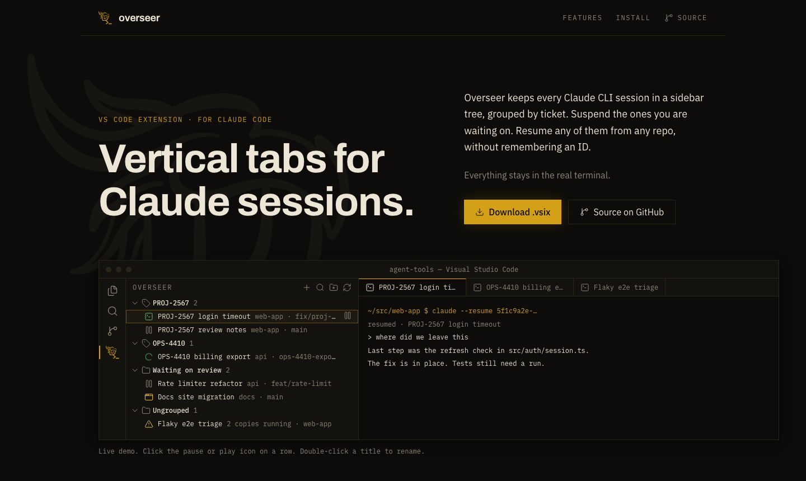

# Overseer

Vertical tabs for Claude CLI sessions in VS Code. Sessions stay real terminals.

[Site](https://tory37.github.io/djaunt-overseer/) · [Download the .vsix](https://github.com/tory37/djaunt-overseer/releases/latest)



## Why

- `claude --resume` only lists sessions that started in the current directory. A fix that started in one repo can't be found from another.
- Idle sessions waiting on review still hold memory. Closing one means remembering its ID to get it back.
- Ten terminal tabs across the top don't say which ticket each one is for.
- The PR and ticket a session worked on are buried in its transcript.

## Features

### Find and resume
- **All Sessions** (search icon in the title bar) lists every Claude session from every repo. Enter resumes it in the directory it started in and pins it to the sidebar.
- `repo:<name>` filters by every repo a session touched, not only the one it started in.
- Sessions that edited files in other repos show `+N repos`.

### Session History
- **Session History** (history icon in the title bar, or the button in All Sessions) opens a page that lists every session. It searches title, prompts, recap, branch, folder, and PR. `repo:<name>` works here too.
- Filter by All, Pinned, or Running, by repo, and by age (idle 7+ days up to 1+ year).
- The detail pane shows the recap, first and last prompt, branch, repos, PR, and commits. **Open** resumes the session. **Pin**, **Copy ID**, and **Open Transcript** are next to it.
- **Delete…** removes one session from your machine for good: its transcript, subagent and tool output, `file-history`, `session-env`, its prompts in `~/.claude/history.jsonl`, and Overseer's pin, label, group, and status. A confirm screen lists everything first. Nothing goes to the Trash.
- **Purge…** deletes every session the current filters show. Pinned sessions are skipped. Purging more than one asks you to type the count.
- Running sessions are never deleted.

### Workspaces (experimental)
> Experimental. It works, but it needs more testing. Report anything odd.

- **Switch Workspace** (the layers item on the left of the status bar) keeps sets of sessions, terminals, and groups apart, like work and after hours. **Default** always exists.
- New sessions, terminals, and groups join the current workspace. **Move to Workspace…** (right-click) moves one.
- A switch suspends the running Claude sessions, closes the terminals and file tabs, then brings back what was open in the other workspace. Terminals come back as fresh shells in the same folder.
- It asks first when Claude is mid-task or a file has unsaved changes. Cancel changes nothing.
- Untitled tabs and tabs pinned in VS Code stay open in every workspace. Split layouts don't come back.

### Group
- Pinned sessions without a group sit in **Ungrouped**.
- **New Group** (title bar) makes your own group. Drag sessions into it.
- Each group row has **+** (new session in that group) and **search** (pull an existing session into that group).

### Reorder
- Drag a group onto another group, or a session onto another session.
- Dragging down puts the item after the target. Dragging up puts it before. VS Code trees can't show an insertion line.
- The order syncs across windows.
- Workstreams reorder in the Session sidebar. See [Workstreams](#workstreams).

### Run
- Clicking a session with a terminal in this window focuses the terminal. Clicking any other session opens it in the [preview](#session-preview).
- **New Session** (+) asks for a folder and an optional name, then runs `claude --session-id <id> -n <name>` in an editor terminal.
- **New Terminal** asks the same questions, then opens a plain shell in that folder. It sits in the Terminals view, under the same groups as your sessions. It acts like a session: click to focus, drag into a group, Rename, Remove, Kill. When it is closed, **Open** starts a new shell in the same folder. Claude-only actions do not show on it.
- Clicking a terminal tab selects that session's row in the sidebar. A row that is already selected stays, so a multi-select survives.
- **Suspend** (pause) sends `/exit`, so the process and its memory go away. It warns first when Claude is mid-task.
- **Resume** (play) brings the session back with its history.
- The analyzer names each session in 2 to 5 words, by what it is about. A ticket key from the launch name keeps the session under its ticket, and shows in the row's description when the title drops it.
- **Rename** (F2 or double-click) renames the row and its tab, and locks the title so the analyzer leaves it alone. **Unlock Title** hands it back. When the session is idle in this window, it also sends `/rename`. A tab that comes back from a reload without its name gets it again when you focus it.
- **Kill and Remove** (right-click) closes the terminal, ends the process, and unpins it. The transcript stays, so All Sessions can still resume it.
- **Remove from Sidebar** only unpins.
- Hovering over a session shows its name, state, and status. Everything else is in the Session sidebar.
- Right-click a session for its actions, in groups: Resume or Suspend and Handoff; the **Claude** submenu (Compact, Clear Context, Switch Model, Show Cost, Commands), shown when the session runs here and is idle; Rename, Unlock Title, and Set Status; Update Now, Recheck, and Flag; Open Repo; Move to Workspace; the **Pixel Guy** submenu; and Remove or Kill.

### Statuses
- **Set Status…** (right-click a session, or **Set Status…** in the palette for the selected rows) marks a session or terminal with a status. **Clear Status** removes it.
- With no status set, the Session sidebar shows the status the analyzer derived, marked as automatic. A status you set wins.
- The defaults are Todo, Triage, In Progress, Blocked, AI Review, Human Review, and Ready to Ship. They do not follow Jira, so a status like Triage works.
- A status with **Ask why** on (Blocked, by default) asks for a reason when you set it. Press Enter to skip. The reason shows in the row's tooltip and on the badge's hover. Setting another status clears it.
- A status tints the row's label and adds a short badge on the right, like `IP`. The icon shows in the picker and the hover, so the row keeps one icon.
- **Settings…** → **Statuses** adds, renames, reorders, and deletes statuses, and sets each one's color, icon, badge, and whether it asks why. Renaming keeps the status on its sessions. **Reset to defaults** restores the seven.
- Colors come from a palette of nine theme colors, because tree labels take only theme colors. They follow your light or dark theme. If a badge shows with no tint, turn on `explorer.decorations.colors`.
- The list is the `overseer.sessionStatuses` setting. Each session's status is saved in the extension's state.

### Compacting
- A session that is compacting shows a spinning sync icon in place of its running icon.
- Claude Code doesn't report compaction anywhere Overseer can read, so this needs two hooks. A `PreCompact` hook writes a marker file to `~/.claude/overseer/compacting/`, and a `PostCompact` hook deletes it. A marker older than 10 minutes is ignored.
- On startup, Overseer offers to install the hooks when they are missing. **Overseer: Install Compact Hooks** and **Overseer: Remove Compact Hooks** in the Command Palette do the same any time. Install backs up `~/.claude/settings.json` first and leaves your own hooks alone.

### Repos
- Overseer works in a window with no folder open. It reads git straight from the repos your sessions use.
- The **Repos** view, under Terminals, lists every repo a pinned session or terminal works in. The most recently active repo is on top.
- Each row shows the branch, commits ahead and behind its upstream, and the count of changed files, like `main · ↑2 ↓1 · 5 changed`. The icon turns amber when there are uncommitted changes.
- Rows update a second after anything changes in the repo's `.git` folder, and when the window gets focus. Git runs only while the view is open.
- **Open Repo in Source Control** (the inline icon, right-click a session, or the palette) adds that repo to VS Code's Source Control view, so its graph, changes, and diffs work there. A session that touched more than one repo asks which.
- **Open Repo in New Window** and **Copy Repo Path** are on the right-click menu.
- Expand a repo to see its last 20 commits on the current branch: subject, short hash, and age.
- A commit a Claude session made shows a green sparkle and the session's name. Overseer knows a session made it when the transcript holds that commit's `git commit` output. It doesn't guess from timing.
- Click a commit to open its diff. Right-click for **Show Session**, **Open Commit on GitHub**, and **Copy Commit Hash**.

### Session sidebar
- The **Session** view in the Secondary Side Bar (Cmd+Option+B) follows the focused session: a Claude terminal or the preview tab. It opens once on its own, the first time a Claude terminal gets focus.
- The header shows the session's name, state, folder, and branch.
- **Suspend** or **Resume** sits under the header. A session running in another window offers a fork instead.
- **Now** shows the analyzer's lines on where the work stands, and when it last updated them. **Work** comes next.
- Other actions are on the session's right-click menu in the tree. The **Claude** submenu holds Compact, Clear Context, Switch Model, Show Cost, and Commands. They send `/compact`, `/clear`, `/model`, `/cost`, or one of your saved prompts, and show only for a session running in this window while it is idle.
- **Commands…** prompts come from the `overseer.sessionCommands` setting, as `{name, prompt}` entries, like "Latest reviews are in on the PR. Pull them and evaluate." A `{ticket link}` in a prompt asks for that value first.

### Office
- The **Office** view, below Session, gives every session in the sidebar a pixel guy. The session's id picks his looks, so he stays the same guy across reloads.
- Each guy has a race, every one as likely as human: orc, goblin, elf, dark elf, dwarf, grey and green aliens, demon, vampire, zombie, skeleton, troll, gnome, fae, undine, lizardfolk, catfolk, wolffolk, minotaur, robot, cyclops, squidfolk, mushroom folk, golem, ghost, slime, dryad, jackalfolk, harpy, centaur, naga, merfolk, satyr, dragonkin, and ogre. Visitors get races too. **Pixel Guy → Pick Race…** on a row's menu picks one and keeps the rest of his look; `overseer.office.races` off makes everyone human.
- While his session is busy he types at his desk. When it goes idle he leans back, then gets up: the water cooler, the coffee machine, the couch, a walk, or a chat with another idle guy. When the session gets busy again he runs back to his desk. A suspended session's guy falls asleep on his desk until it resumes. A session that leaves the sidebar walks out the door.
- His portrait is the session's row icon in Sessions and Terminals, with the state as a badge in the corner. It pulses while working; a suspended session's guy is dimmed. **Re-roll Pixel Guy** on a row's menu gives the session a new one, race and all, and **Reset Pixel Guy** brings the first one back.
- The room has room for ten desks, plus a couple past your sessions as more open, and takes the shape that shows the most at the biggest zoom. The only desk standing from the start is yours. When a session joins, two maintenance guys in hi-vis walk in, one carrying the desk overhead and the other its chair, and set it down while the new guy waits beside the spot ("desk?"). When a session ends they come back and carry its desk out. A desk a guy left behind goes to the next one in. When the view opens, the sessions already running have their desks.
- Each desk suits its owner's race: crates for orcs, goblins, trolls, and ogres; a workbench with a hammer for dwarves and gnomes; a stump with leaves for elves, dryads, fae, satyrs, centaurs, mushroom folk, and wolffolk; black with a candle for dark elves, demons, vampires, skeletons, zombies, and ghosts; a glowing console for aliens and squidfolk; black with a running LED for robots; coral and a shell for undines, merfolk, nagas, and slimes; a rune-lit stone slab for golems, cyclopes, minotaurs, lizardfolk, and jackalfolk; a pile of gold for dragonkin; a ball of yarn for catfolk; a twig nest with an egg for harpies; and the plain office desk for humans.
- You're in the room too, at your own station in the middle: a double desk with two monitors. You type, lean back, and every so often take a break to wander, grab a coffee, or shoot the breeze with someone, idle or busy at their desk. When an event hits you run back to your desk and act out the ERROR, HACK, and DEFENSE scene events with the other views: your main monitor flashes red, rains green code, or runs the defense bar up to a shield, and the second one shows the error log, more code, or a radar sweep. Between events its graph takes Core's color, and changes with it when Core's scan sweeps a new one across the globe. You jump up, hack like mad, and cheer. The room's screens flash with it, and the others look up. A lucky cat clock waves from the back wall. `overseer.office.yourLook` sets your look (a blonde ponytail with a shaved side, blue eyes, a thick orange beard, a black muscle shirt, white shorts, and black flip flops by default); `overseer.office.you` takes you out.
- Click a guy to open his session. Hover for its name. The guy of the session the Session sidebar shows wears a little gold crown.
- **Switch Office Scene…** (the button on the view) picks the room: Office, Server Room, Forest, Field, Riverbed, Cave, or Moon.
- Every 10-25 seconds a few critters for the scene run across the room, five kinds per scene: a mouse, cat, roomba, corgi, and hamster ball in the office; a mouse, rat, roomba, spider, and drone in the server room; a fox, rabbit, squirrel, hedgehog, and raccoon in the forest; a hen and her chicks, sheep, rabbit, pig, and butterflies in the field; frogs, a duck and her ducklings, a turtle, otter, and crabs by the river; bats, a rat, beetle, spider, and slimes in the cave; aliens, a rover, moon bunny, UFO, and astronaut on the moon. Idle guys they pass stop to watch and say something.
- Every 25-60 seconds something for the scene flies over: pigeons, a paper plane, moths, a lost balloon, and sparrows in the office; flies, a drone swarm, a robot bird, and a ghost in the server room; owls (at night), crows, bluebirds (by day), a swooping hawk, and fireflies (at night) in the forest; a V of geese, swallows, bees, crows, and a hot-air balloon over the field; a heron, dragonflies, a kingfisher, gulls, and mallards by the river; a dragon, wisps, a phoenix, a ghost, and moths in the cave; a rocket, a satellite, a space whale, meteors, and star jellies on the moon. Big ones cast a shadow, glowing ones light up at night, and idle guys under them look up.
- The light follows your clock and the season: sunrise, golden hour, sunset, and night, with the sun and the moon in its real phase crossing the field's sky. Outdoor scenes go dark at night, lit by the screens, lamps, and campfires; the office keeps its lights on and its windows go dark; the server room and the cave never see the sky. On the moon a day lasts a month, and the Earth overhead shows the opposite phase.
- People from other departments drop in: HR, IT, Sales, Marketing, Facilities, Accounting, Legal, an intern, and now and then a manager in a tie ("Are you all getting work done in here?", "Keep up the synergy!"). Up to five hang around at once. Each says his piece in the middle of the room; some leave right away, most stay a minute or two, and some settle in for up to ten, chatting with the guys, getting coffee, sitting on the couch, and looming over whoever's busy ("Any blockers?"). `overseer.office.visitors` sets how often they come. Everyone answers in his own way, set by his looks' seed: the suck-up says "OK BOSS!", the reasonable ones grumble, others go "Wow ok.", roll their eyes, or jump on it, and sleepers mumble.

### Session preview
- A session with no terminal in this window opens in one reused **Session Preview** tab. Clicking another session replaces it.
- It shows where the session left off, its last turns, its prompts, the commits and pull requests the transcript shows it made or worked on, and the other repos it touched.
- **Resume** opens the terminal in the preview's place and closes the preview.
- The preview reads the transcript and git, so it costs nothing and never starts Claude.

### Workstreams
- The Session sidebar groups a session's PRs, tickets, artifacts, and commits into workstreams, with a few lines on where the work stands.
- A headless Haiku pass builds them from the transcript. It runs on its own after a session goes idle, when the gates in **Settings…** → **Analyzer** pass: idle seconds, new prompts, new KB or a new link, and a cooldown. `overseer.analyzer.auto` turns it off.
- **Update** runs a pass on what is new now. **Recheck** rebuilds the workstreams from the whole transcript.
- **Flag: This Didn't Update** logs a diagnostic snapshot to `~/.claude/overseer/analyzer-flags.jsonl` when a pass didn't come when you expected.
- Each analyzer call logs its cost and tokens to `~/.claude/overseer/analyzer-usage.jsonl` and an `[analyzer] usage` line in the Overseer output.
- Your edits win over every pass: rename a workstream, drag an item to another one, reorder workstreams, mark one done, or remove an item.
- Items the model has not placed show under **Unsorted**. Removed items show under **Removed**, where **Restore** brings them back.
- Each row has **Open in Browser** and a **More Actions** menu: **Open in VS Code**, **Copy Link**, **Move to Status…** (tickets), and **Remove from This Session**.
- **Open in VS Code** always opens a new browser tab. VS Code gives extensions no way to find an open one.
- Each PR and ticket shows its live status, and its icon takes that status's color. Overseer checks every five minutes while the sidebar shows them.
- PR status comes from `gh`. Ticket status comes from the Jira MCP server in your `~/.claude.json`, the same one Claude Code uses. Overseer starts it on its own and reads all visible tickets in one call.
- **Jira Settings…** lists each Jira project Overseer has seen, like ASSMNT or CR, with its full status list and a color for each status. Turn a project off to stop its status lookups.
- **GitHub Settings…** sets one color per PR state: draft, open, review required, approved, changes requested, merged, and closed.
- Status colors follow your theme until you pick one. A picked color wins over the theme. The theme ids are `overseer.prDraft` through `overseer.prClosed` and `overseer.ticketBlocked` through `overseer.ticketOther`, so `workbench.colorCustomizations` can set them too.
- Overseer tells the agent nothing. Sessions launch as plain `claude`, with no plugin, skill, or CLI.
- Old `~/.claude/overseer/declared/`, `work/`, and `where/` files seed a session's first analysis once. Overseer never changes or deletes them.

### Settings
Type "Overseer" in the command palette (Cmd+Shift+P) for every setting:

- **Settings…** opens the Overseer Settings panel. Its General section shows or hides the Sessions, Terminals, and Repos views. It is also in the sidebar's `...` menu.
- **Session Icon Settings…**, **Jira Settings…**, and **GitHub Settings…** open the panel at that section.
- **Enable/Disable Jira Integration**, **Enable/Disable GitHub Integration**, and **Enable/Disable Artifact Links** turn a link source on or off. The palette shows only the one that applies.
- **All Settings (Settings Editor)** opens every `overseer.*` setting in the native editor.
- Session icons take any [Codicon](https://microsoft.github.io/vscode-codicons/dist/codicon.html) name and any color. Colors save to `workbench.colorCustomizations` as `overseer.sessionWorking`, `overseer.sessionRunning`, `overseer.sessionElsewhere`, `overseer.sessionSuspended`, `overseer.sessionDuplicate`, and `overseer.sessionCompacting`.

### Guard
- Live status comes from `claude agents --json`: working, running here, running in another window, or suspended.
- Resuming a session that runs elsewhere offers a fork instead. Two processes on one transcript corrupt it.

## Install

```bash
curl -LO https://github.com/tory37/djaunt-overseer/releases/latest/download/djaunt-overseer-0.0.46.vsix
code --install-extension djaunt-overseer-0.0.46.vsix
```

If `code` isn't on your PATH, use `"/Applications/Visual Studio Code.app/Contents/Resources/app/bin/code"`.

Then run **Developer: Reload Window**. Cmd+R only reloads in the F5 development host.

For the matching look, run **Preferences: Color Theme** and pick **Overseer Hoard** (or Ember, Frost, Parchment). Each edges the window and the focused tab, list, and widgets in its accent color.

VS Code's modern UI reads tab colors only from settings, so with an Overseer theme active Overseer adds the focused tab's tint and edge to your user `workbench.colorCustomizations`. It keeps your own values. Turn it off with `overseer.theme.tabSpotlight`.

## Requirements

- VS Code 1.106 or later.
- Claude Code CLI on your login shell's PATH.
- Optional: `gh` for PR status, and a stdio Jira MCP server in `~/.claude.json` for ticket status. Without them, links show with no status.
- Tested on macOS only.

## Settings

| Setting | Default | Meaning |
| --- | --- | --- |
| `overseer.claudeHome` | `~/.claude` | Where Claude keeps `projects/` and `sessions/`. |
| `overseer.links.github.enabled` | `true` | Show GitHub PRs under each session. |
| `overseer.links.jira.enabled` | `true` | Show Jira tickets under each session. |
| `overseer.links.artifacts.enabled` | `true` | Show claude.ai artifacts under each session. |
| `overseer.links.commits.enabled` | `false` | Show commits in the Session sidebar. |
| `overseer.links.prs.openOnly` | `true` | Hide merged and closed PRs in the Session sidebar. A PR with no known status still shows. |
| `overseer.links.jira.baseUrl` | empty | Jira site for tickets whose URL the transcript doesn't show, e.g. `https://acme.atlassian.net`. |
| `overseer.jira.mcpServer` | `jira` | Name of the stdio Jira MCP server in `~/.claude.json`. |
| `overseer.links.liveStatus` | `true` | Show PR and ticket status through `gh` and your Jira MCP server. |
| `overseer.summary.model` | `haiku` | Model for Summarize with Haiku. |
| `overseer.sessionCommands` | three starters | Prompts the **Commands…** picker sends. `{name}` in a prompt asks for a value. |
| `overseer.sessionIcons.working` | `loading~spin` | Icon for a session working in this window. |
| `overseer.sessionIcons.running` | `terminal` | Icon for a session running in this window. |
| `overseer.sessionIcons.elsewhere` | `window` | Icon for a session running in another window. |
| `overseer.sessionIcons.suspended` | `debug-pause` | Icon for a suspended session. |
| `overseer.sessionIcons.duplicate` | `warning` | Icon for a session with more than one copy running. |
| `overseer.sessionIcons.compacting` | `sync~spin` | Icon for a session that is compacting. |
| `overseer.office.portraits` | `true` | Show each session's pixel guy as its row icon, with its state as a badge. Off uses the `overseer.sessionIcons.*` codicons. |
| `overseer.office.scene` | `office` | The Office view's room: `office`, `serverRoom`, `forest`, `field`, `riverbed`, `cave`, or `moon`. |
| `overseer.office.sleepers` | `true` | Give suspended sessions a guy too, asleep at his desk. |
| `overseer.office.critters` | `true` | Critters for the scene run across the Office now and then. |
| `overseer.office.fliers` | `true` | Creatures for the scene fly over the Office now and then. |
| `overseer.office.dayNight` | `true` | Light the Office by your clock. Off keeps it daytime. |
| `overseer.office.races` | `true` | Give the pixel guys races, each as likely as human. Off makes everyone human, except guys you picked a race for. |
| `overseer.office.visitors` | `normal` | How often people from other departments, and sometimes a manager, drop in: `off`, `rare` (every 3-6 min), `normal` (1-2.5 min), `often` (25-75 s), or `packed` (8-30 s). Up to five hang around at once and the room answers them. |
| `overseer.office.you` | `true` | Put you in the Office, at your own two-monitor station in the middle, reacting to the scene events. |
| `overseer.office.yourLook` | `{}` | Your guy's look: `skin`, `hair`, `hairStyle`, `eyes`, `beard`, `shirt`, `sleeveless`, `pants`, `shorts`, `shoes`, `flipFlops`, `accessory`, `accessoryColor`. Leave a field out for the default. |
| `overseer.views.office` | `true` | Show the Office view. |

The analyzer and Summarize with Haiku run through your `claude` CLI, so they count against your Claude usage. Everything else makes no model calls.

## Build from source

```bash
npm install
npm test
npm run package
code --install-extension djaunt-overseer-0.0.46.vsix --force
```

Not affiliated with Anthropic.
